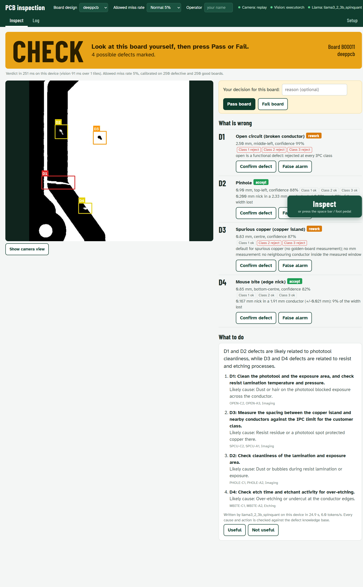
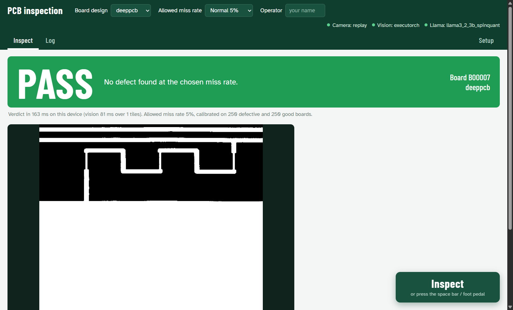
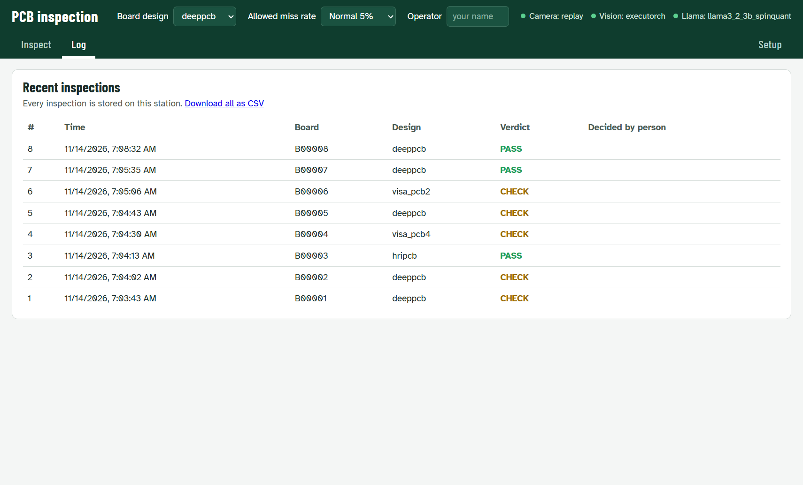

# PCB Inspection Station: Technical Report

Arm Bharat AI-SoC Challenge 2026-27, Problem Statement 5: real-time industrial defect detection and quality-control assistant.

## Summary

**One station, one question: is this bare circuit board good?**

1. A board is placed under the camera of a Raspberry Pi 5. Nothing leaves the Pi.
2. The picture is compared with a known-good board of the same design. Every difference is named (open, short, mouse bite and eight more types), measured in millimetres and graded.
3. The board gets PASS, FAIL or CHECK, and a green, red or amber light. CHECK means the station is not sure and a person decides.
4. Llama 3.2 on ExecuTorch reads the findings, never the picture, and tells the operator the likely cause and the next action, in knowledge-base wording.
5. The inspection is logged on the device.

On boards it had never seen, with the miss rate set to 5%, it missed 4.0% of defects and raised 0.29 false calls per board (section 3.3).

Every inspection system quotes an accuracy figure. None of the ones we reviewed tells a factory what it needs before trusting it: **the smallest defect it will reliably catch on this camera, on this line, today.** This station does, in three ways:

1. **It measures its own detection limit, like an eye test.** The operator photographs a printed test card carrying 252 defects of known size. The station reads the card and states, per defect type, the smallest size it finds 90% of the time with 95% confidence (the a90/95 figure from the US military's non-destructive-testing handbook, MIL-HDBK-1823A). It also says plainly which sizes it cannot certify.
2. **It says when it is unsure, at a miss rate the operator sets.** Every board gets PASS, FAIL or CHECK. The operator picks how many defects may slip through (1%, 5% or 10%). Conformal calibration sets the threshold so that rate holds, statistically, on boards like the calibration boards, and sends the uncertain ones to a person. On held-out boards at a 5% setting the deployed station (detector plus golden board) missed 4.0% of defects.
3. **It refuses customer rules it cannot keep.** A customer's acceptance rules arrive in plain English ("reject mouse bites that remove more than 20% of the trace width"). Llama on ExecuTorch turns each clause into an executable rule, choosing only among answers the clause supports (constrained decoding on the exported model). Deterministic checks verify it, and the station compares it with the measured detection limit. If the station cannot see defects that small, it says so instead of silently accepting the rule.

The same station also checks assembled boards, as a second and simpler path: it learns what a good board looks like, flags any area that differs, and names a part that is missing (section 3.2).

| What a reviewer can check | Where |
|---|---|
| Detects, names, measures (mm) and grades defects | Sections 3, 4 |
| PASS / FAIL / CHECK at an operator-chosen miss rate | Section 5.1 |
| Detection-limit card and its statement | Section 5.2 |
| Plain-English rules compiled by Llama and checked | Section 5.3 |
| Llama advice that cannot invent instructions | Section 6 |
| Everything on the Arm CPU, offline | Section 7 |
| Learns new boards and from operator feedback | Section 9 |
| Every number measured, none projected (speed, memory and power on the Pi are marked pending until measured there) | `docs/RESULTS.md` |

## 1. Problem and scope

Printed circuit boards fail in a small set of ways:

- conductors are cut or nicked (open, mouse bite, pinhole)
- copper is left where it should not be (short, spur, spurious copper)
- holes or pads are missing or damaged, holes break out of their pads
- the surface is scratched or carries a foreign object
- on assembled boards, components and solder joints go wrong in open-ended ways

An inspection station in a small electronics shop has to find these quickly, decide what each one means, tell the operator what to do, and keep a record, without a network connection. The shop also has to decide whether to trust it. That last question is the one this project is built around.

**What PS5 asks for, and where it is:**

| PS5 requirement | Section |
|---|---|
| Detect defects, cracks, anomalies | 3 |
| Classify type and severity | 3, 4 |
| Alert operators with actionable recommendations | 5.1, 6 |
| Log inspection results | 8 |
| Real time at the edge, no cloud | 7 |
| Llama via ExecuTorch for reasoning | 5.3, 6 |

## 2. System overview: two pipelines

PS5 asks for the vision and Llama pipelines to be documented separately, so they are.

**Vision pipeline (ExecuTorch with the XNNPACK delegate, or Arm's optimised runtime, on the Arm CPU)**

1. **Capture.** Pi Camera through Picamera2 (focus locked by a sweep, exposure and white balance locked, frames averaged, optional RAW and flat-field correction), a USB webcam, or replay of held-out boards.
2. **Board identity and scale.** A QR code gives the board ID. A printed ArUco marker beside the board gives millimetres per pixel.
3. **Golden-board comparison, first.** When a reference picture of the design exists (every board taught on the station has one), the board is aligned to it and the copper is compared. This sees any copper change, measures every defect in millimetres, and checks connectivity: two conductors joined is a short, one conductor split is an open. A board that does not line up with its reference is never passed; it goes to a person.
4. **Named defects.** A YOLO26n detector on 640-pixel tiles names 11 bare-board defect types. On taught boards it runs only on the tiles where the golden comparison found a difference, so a clean board costs no detector time.
5. **Unknown defects.** A ResNet-18 patch-feature memory of good boards flags anything that differs from them. This path covers assembled boards.
6. **Severity.** Measured width or spacing loss against IPC-style limits for Class 1, 2 and 3.
7. **Decision.** The conformal gate gives PASS, FAIL or CHECK at the chosen miss rate. Customer rules, if any, are applied after it.
8. **Outputs.** Stack light and buzzer on GPIO, the dashboard, and the SQLite log.

**Reasoning pipeline (ExecuTorch, Llama 3.2 Instruct SpinQuant INT4, Arm CPU)**

One Llama 3.2 3B model does all three jobs; the 1B model is the fallback.

1. **Advice.** Llama reads a structured defect record (type, size, severity, location, recent history), never pixels, and chooses causes and actions from knowledge-base options. Its choices are read from next-token scores, not parsed from text. A grounding checker validates the answer.
2. **Customer rules.** Llama fills a fixed rule form from each plain-English clause. The rule is verified and compared with the measured detection limit.
3. **Shift questions and alerts.** Llama picks one of the station's fixed read-only queries for a typed question and words the rows; it also words drift alerts.

The verdict never waits for Llama. Advice is produced on a background thread and appears seconds later.

## 3. Vision

### 3.1 Bare-board detector

**Data.** Five public sources, unified into 11 classes: missing hole, mouse bite, open, short, spur, spurious copper, pinhole, damaged pad, hole breakout, scratch and foreign object.

| Source | What it is | How it is split |
|---|---|---|
| DeepPCB | 1,500 binarised image pairs with a defect-free template, 48 px/mm | Official split |
| PKU-Market-PCB (HRIPCB) | 693 colour photos of 10 boards | By physical board |
| Mendeley PCB-Defect (2025) | 230 real etched boards, flatbed scans | By board group |
| DsPCBSD+ (Lv et al., 2024) | 10,259 crops of real production-line AOI defects | Its own validation split is our test set |
| DefectDet (Azam et al., 2026) | 268 photos of real manufactured double-layer boards | **By physical board**: half the boards train, the other half are test only |

The sources look very different: binarised, green solder mask, bare copper, production AOI crops, phone-style photos. That variety is deliberate. Training also recolours the binarised scans as real finishes (green, blue, red, black, white, yellow and purple solder mask, bare copper, tinned copper) and simulates camera effects, so the model does not learn one look.

**Tiling.** Large frames are cut into 640-pixel tiles with 128 pixels of overlap, with the same code in training and inference. Detections are merged with NMS.

**Model.** YOLO26n, trained on a cloud GPU before deployment (the "trained beforehand" half of the brief), then exported to ExecuTorch (XNNPACK, FP32 and INT8) and to Arm's Optimized-Runtimes YOLO26 build for the Pi 5.

**What more data bought.** Each version was tested on the same held-out boards (mAP@0.5):

| Detector | All test boards | DeepPCB | HRIPCB | Mendeley | DsPCBSD+ | DefectDet (unseen boards) |
|---|---|---|---|---|---|---|
| First version (3 sources) | 33.2% | 96.6% | 97.3% | 83.7% | 0.1% | 17.8% |
| + DsPCBSD+ | 70.4% | 96.6% | 91.2% | 83.3% | 75.1% | 30.2% |
| + DefectDet boards, recolouring (deployed) | 83.3% | 96.3% | 95.8% | 81.1% | 73.8% | 84.2% |

The deployed numbers hold for what ships: running the same test boards through the exported ExecuTorch `.pte` (FP32, XNNPACK) gives the same mAP to within 0.05 points on every test set (all boards 83.31% against 83.32% in PyTorch). The INT8 export (3.2 MB against 9.8 MB) loses at most 0.4 points on any test set (all boards 83.2%, DefectDet 83.8%), so on the Pi the choice between them is purely a speed question.

**Precision, recall and F1.** For the deployed detector alone, run through ExecuTorch on the same test boards, before the golden comparison and the review gate. A detection is correct when it names the right type and overlaps the labelled defect (IoU 0.5 or more).

| Test boards | Defects | Precision | Recall | F1 |
|---|---|---|---|---|
| All test boards | 7,093 | 76.6% | 81.0% | 78.7% |
| DeepPCB | 1,579 | 83.4% | 97.1% | 89.7% |
| HRIPCB | 610 | 60.3% | 97.5% | 74.5% |
| Mendeley | 207 | 62.8% | 90.3% | 74.1% |
| DsPCBSD+ | 4,092 | 79.3% | 70.9% | 74.9% |
| DefectDet (unseen boards) | 605 | 73.2% | 86.9% | 79.5% |

These are at a confidence of 0.25, which favours recall: the station would sooner show a doubtful box than hide a defect, and the golden comparison (section 3.3) and the gate (section 5.1) are what deal with the false alarms. At 0.5 the figures for all boards are 85.2% precision and 65.8% recall. `docs/RESULTS.md` has both settings and the breakdown by defect type.

The low precision on HRIPCB has a specific cause. Its 123 test photos show two physical boards, each photographed about 60 times with a different drawn-in defect. Of the 318 detections that sit where nothing is labelled, 300 are the same five spots found on photo after photo: on one board a small dark spot in the copper (called a pin hole), a nick in a trace edge (mouse bite), a hair-like mark between traces (spur) and a plated hole (wrongly called a missing hole), and on the other a copper bridge between two pads (called a short). Looking at the crops, the first three look like real flaws in the board that the dataset does not label, and the last two look like the detector misreading a normal feature. Counting each spot once instead of sixty times, precision on HRIPCB is 86.6% instead of 60.3% and F1 is 91.8% instead of 74.5%. We report the as-labelled figure in the table and this one beside it, not instead of it. It is also the case for the golden-board comparison (section 3.3): a feature that is on the good board too is not a difference, so the station does not raise it.

The first version scored 97% on the datasets it was trained on, and 18% on photos of boards from another lab. That gap is the reason the station measures its own limit (section 5.2) instead of quoting a dataset score. The DefectDet test boards are physical boards the model never saw, but they come from the same lab as the training half, so this is not a cross-lab result.

**Larger detectors, and why accuracy alone did not decide.** The same data was used to train two larger models, YOLO26s and YOLO26m. Both find more on every held-out test set (mAP 85.8% and 86.8% against 83.3%; through the exported ExecuTorch files, and the INT8 files lose 0.1 points). At the station's own setting the picture is less simple. Each was given thresholds calibrated on its own scores, and on the DeepPCB test boards at a 5% setting:

| Detector | Missed, with the good board (as deployed) | Missed, detector alone | False calls per board | Boards sent to a person |
|---|---|---|---|---|
| YOLO26n (first) | 4.0% | 6.5% | 0.29 | 20% |
| YOLO26s | 6.1% | 8.2% | 0.28 | 7% |
| YOLO26m | 5.1% | 5.4% | 0.29 | 8% |

YOLO26m keeps its misses close to the target while sending far fewer boards to a person; YOLO26s's detector-alone miss rate (8.2%) is above the 7.2% the calibration can promise with 95% confidence, which should happen only about one time in twenty. So a better mAP did not by itself mean fewer misses on the line, and YOLO26s is not recommended. All three ship, each with its own thresholds; YOLO26m is used if the Pi is fast enough (section 7), otherwise YOLO26n.

**Synthetic boards did not help.** A fourth version added 1,049 tiles rendered from 61 open-hardware KiCad designs with injected defects (labels checked by eye against each clean render). It was no better on the DefectDet test boards (83.9% against 84.2%) and slightly worse on most other sets, so it is not deployed. The rendering pipeline (`training/kicad/`) stays in the repo.

Enlarging small-defect photos before inspection was also tested on the DefectDet test boards. It only hurt: every detector did best at native scale. The deployed detector fell from 84% mAP at native scale to 77% at 1.5x and 49% at 2x.

### 3.2 Assembled boards: anomaly memory

The PS lists anomalies alongside named defects. On assembled boards the variety of defects is open-ended and labelled data is scarce. So the station learns what *good* looks like:

1. **Features.** A frozen ResNet-18 (layer2 and layer3 features, 3x3 local averaging) gives a descriptor for every 8x8-pixel patch of a 320x320 view.
2. **Memory.** Descriptors from good boards are kept in a memory, reduced by greedy coreset selection.
3. **Scoring.** Each patch's distance to its nearest good patch makes the heatmap. The board's score is the mean of its worst 1% of patches, which is steadier than the single worst patch.
4. **Calibration.** Leave-one-out, or a held-out share of good boards, sets the per-design normalisation. These numbers are honest even when a design is taught from five boards.
5. **Export.** The backbone is the only neural network on this path. Its ExecuTorch FP32 export matches PyTorch to about 1e-6 relative error, so a memory built in the cloud is valid on the Pi (measured at 320 px: 1.2e-6).

**How the setting was chosen.** Nine settings were compared on VisA pcb1-4: two backbones, three input sizes, and three scoring refinements. The deployed setting (ResNet-18, 320 px, top-1% score) had a mean image AUROC of 95.6%, versus 90.5% for the first version (256 px, worst patch). It also had the best heatmap (pixel AUROC 97.9%) and tied for the best result when teaching a design from 10 good boards (90.8%, versus 84.5%). A Wide-ResNet-50 was no better and costs several times the compute on the Pi. Per-position normalisation and a board mask raised the full-memory score but hurt the 10-board result and the heatmap, so they are off.

**Naming a missing part.** An unusual area tells a person where to look, but not what is wrong, and patch-feature methods are known to be weakest on parts that are absent or swapped (MVTec LOCO AD; Kim et al. 2024 report 74 against 98 AUROC for a part-aware method on such faults). The station therefore also checks parts one by one (`pcbinspect/parts.py`):

1. **Teaching.** A one-class part detector (YOLO26n, trained on 53 boards of the FPIC dataset) finds every part on the good boards. A part not found on every good photo is left off, and how much each part's picture varies from one good board to the next is recorded. A small classifier names the parts it is sure of (capacitor, resistor, chip, and so on); it runs only at teaching.
2. **Inspection.** The board is lined up with the taught one. A part is called missing only when two cues agree: the detector finds nothing there, and the picture of that place no longer looks like the good board. Something is called unexpected only if the detector is confident and the place looks different. A part that is present but clearly unlike the good one is reported as "looks different".
3. **Verdict.** A parts finding that falls on an area the anomaly memory already flags names it; one that nothing else backs sends the board to a person (CHECK). It never fails a board by itself, because the part detector's confidence is not calibrated. A board that cannot be lined up, or where half the parts disagree, is never passed.

Measured: on 15 FPIC boards never trained on, the part detector reached 97.3% precision and 94.2% recall, and with parts removed in software (a simulation) 86% of removed parts were reported missing with no call at all on any untouched board. On real VisA photos (four designs, faults made by hand, the part detector never saw these boards or this camera), teaching from eight good photos with thresholds chosen on good training photos only:

| VisA test photos | Count | Reported on the labelled spot |
|---|---|---|
| Good boards (any parts call is false) | 320 | 15 raised a call (4.7%) |
| Labelled "missing" | 92 | 56 (61%) |
| Labelled "extra" | 30 | 10 (33%) |
| Labelled "wrong place" | 13 | 11 (85%) |

It works well on two designs (all 33 missing parts on pcb4, 12 of 19 on pcb2) and poorly on two (pcb3 9 of 20, pcb1 2 of 20, where only eight parts could be mapped). These designs had been looked at while building the check, so this is a development result, not a blind test. `docs/RESEARCH_AND_DECISIONS.md` section 5 has the literature behind the design and what it does not support claiming.

**Second dataset.** On Real-IAD's `pcb` object (five camera views per board, evaluation only, never trained on), the same method (ResNet-18, 320 px) reached a mean image AUROC of 90.6% across the five views (89.2% to 93.0%), with one memory per view built from that view's good images.

### 3.3 Golden-board comparison and fusion

When a known-good image of the design exists, the station compares against it, which is how industrial AOI works:

1. Align the board to the golden image (ECC, affine), then re-register locally to remove residual warp.
2. Segment copper in both, choosing the colour channel with the most contrast.
3. Compare copper fractions, not hard masks, so a short across a gap narrower than a pixel still shows.
4. Remove thin slivers that hug an edge (registration noise, not defects).
5. **Check connectivity.** Two golden conductors now joined is a short. One golden conductor now split is an open. Either upgrades the candidate to a near-certain defect.
6. Fuse with the detector: the higher confidence wins, boxes are merged.

On DeepPCB test boards (250 defective boards with 1,579 defects, and 250 good boards), with the golden image re-captured under a random warp, each channel with its own per-defect gate at the same 5% setting:

| Evidence | One random defect per board missed (95% CI) | False calls per board (all 500) | Named correctly |
|---|---|---|---|
| Detector only | 6.3% (4.9% to 7.9%) | 0.12 | 99% |
| Golden difference only | 5.2% (3.9% to 6.6%) | 0.49 | 81% |
| Fused (deployed) | 4.0% (3.1% to 5.0%) | 0.29 | 99% |

**What it does with the verdict.** In this mode 95% of the good test boards PASS and none FAIL. No defective board passes, but none is failed automatically either: all go to a person (CHECK). The reason is in the scores, not a setting. Where the golden comparison sees a broken or joined conductor it is near-certain (0.99), and 4.8% of good DeepPCB boards also produce such a call somewhere, so a threshold that fails at most 1% of good boards cannot sit below 0.99. A board taught on the station is calibrated on its own captures (section 9) and does FAIL a cut board; on DeepPCB, the station finds the defects and a person confirms them.

Fusing keeps the detector's naming and the golden comparison's reach: fewer misses than either alone, inside the 5% target. In the fused channel a detection with no copper change under it is kept but trusted at 0.7 of its confidence: the golden board saw nothing there. That setting (0.7 and 0.5 gave the same result) cost 0.2 points of misses on these boards and removed false calls here and, more so, on the eye-test card (section 5.2).

Three properties of this channel were found wanting in review and fixed, each with a test:

- **Placement tolerance.** Alignment used to lose a board shifted by more than about 2% of the frame width or turned by more than about 1 degree, a couple of millimetres on a fixture. It is now coarse to fine (rigid at 160 px from several starting rotations, rigid at 400 px, affine at 1,000 px) and holds at a 12% shift and 5 degrees on a real board photo, in about a second on a laptop.
- **A refused comparison is never a PASS.** If the board cannot be aligned or shows no copper contrast, the detector's opinion alone does not clear it: the verdict is CHECK and the screen says to re-seat the board.
- **Connectivity evidence must be robust.** On camera-like pictures, one pixel of blur or resampling could join two shapes that almost touch, or split a neck three pixels wide, and a good board was reported as a short or an open (3 of 8 re-captures in one test). A short now counts only between conductors that stay separate when the reference copper grows by one pixel, and an open only where the conductor survives shrinking by two.

**Speed.** The reference picture is decoded once and aligned once per board (the millimetre measurement reuses the alignment). Per-difference work happens in a small window instead of on the full frame, which made a 12 MP frame with 300 differences three times faster with identical results on 60 board pairs.

### 3.4 Measuring defects in millimetres

A detection box is drawn loosely around a defect, so its size is not the defect's size. An early version that measured boxes produced impossible values such as "291% spacing reduction". The station therefore measures from the golden comparison:

- **Missing copper:** the nick depth is the short side of its minimum-area rectangle; the local conductor width comes from the golden image's distance transform. The result is a % width reduction.
- **Extra copper:** the remaining gap is the shortest distance to a *different* golden conductor. The result is a % spacing reduction. A short is sized by the gap it bridges.
- With no golden image, the station makes no millimetre claim and uses the defect-type default severity.

**Scale** comes from the printed ArUco marker. Measuring a marker sheet rendered at a known 300 dpi with the station's own code gives 0.12% error. For the Mendeley scans it comes from the dataset's 20 mil minimum-trace design rule, measured from the copper (implied 1,249 dpi). The camera can be calibrated with a ChArUco board (`deploy/calibrate_camera.py`) to remove lens distortion.

## 4. IPC-style severity

The limits in `config/severity.yaml` are the commonly quoted IPC-A-600 width and spacing reduction limits from cited secondary sources: 30% for Class 1, 20% for Class 2, 10% for Class 3. We do not have the licensed standard, so the file is editable and the limits are stated as configurable, not authoritative.

- **Critical:** rejected even at Class 1.
- **Major:** rejected at Class 2.
- **Minor:** rejected only at Class 3.

Shorts, opens and missing holes are functional failures, rejected at every class.

**Location.** The PS guidance asks for severity from type, size and location. Location enters in one way: what the defect sits on. A nick in a conductor is graded by the share of the conductor's width it removes; a defect in a gap is graded by the share of the spacing it closes, and a defect that joins two conductors or cuts one is a functional failure wherever it is. Where on the board it sits (top-left, centre, and so on) is recorded and shown to the operator and to Llama, but does not change the grade: we have no design data saying which areas matter more, and inventing a weighting would make the grade look more informed than it is.

**Severity is not confidence.** A named defect's severity comes from its type and its measured size against the limits above: the share of a conductor's width it removes, or the share of a gap it closes. The detector's confidence plays no part in it: confidence only decides whether the station is sure enough to call PASS or FAIL by itself (section 5.1). An unnamed anomaly has no type, so it is graded by the area it covers in mm2, with thresholds that are our own assumption and are marked as such in the file. Only when the station has no millimetre scale for the board does it fall back to grading an anomaly by how far its score is from normal, and it says so in the reason shown to the operator.

## 5. A station that knows its limits

### 5.1 PASS / FAIL / CHECK with a guaranteed miss rate

Every detector has a threshold, usually picked by eye, which says nothing about how many defects will slip through. The station uses **split-conformal risk control** instead:

- On held-out calibration boards, take one randomly chosen real defect per board and record how strongly the station sees it.
- The threshold λ is the k-th smallest of those n scores, with k = ⌊α(n+1)⌋. A new defect from the same process is then missed with probability at most α, whatever the score distribution.
- A second threshold τ bounds the share of good boards failed.
- Boards between the two go to a person: the CHECK verdict, amber light. The operator picks α (1%, 5% or 10%) and sees the review queue grow or shrink.

The guarantee is per defect, which is what matters to a customer. An earlier per-board version showed only 34% of the individual defects on boards it correctly failed, so it was replaced.

On held-out test boards at a 5% allowed miss rate:

| Design | Defective / good test boards | One random defect per board missed (95% CI) | All defects missed | False calls per board | Boards sent to a person |
|---|---|---|---|---|---|
| DeepPCB | 250 / 250 | 6.5% (5.0% to 8.1%) | 6.8% of 1,579 | 0.12 | 20% |
| HRIPCB | 121 / 2 | 4.5% (2.8% to 6.3%) | 4.4% of 610 | 1.07 | 100% |
| Mendeley | 27 / 0 | 3.6% (1.1% to 6.4%) | 3.4% of 207 | 7.07 | 100% |

The detector alone misses 6.5% here and 6.3% in the golden-board table of section 3.3. Both are measured on the same DeepPCB test boards, but they count a defect as seen in slightly different ways: here a detection must overlap the defect (IoU of 0.3 or more); in section 3.3, where the golden comparison's free-form regions are scored too, a detection also counts if it overlaps a little (IoU 0.1) or its centre lies inside the defect. Each gate is calibrated with its own rule, so each figure is correct for its own table.

**What the calibration actually promises.** Split-conformal calibration bounds the miss rate at the target *on average over calibration sets*. A station has one calibration set, and for that one set the miss rate is itself uncertain: with n calibration defects and the threshold at the k-th smallest score, it follows a Beta(k, n + 1 - k) distribution (Vovk, 2012). The station therefore states both numbers: the target, and the level it will not exceed with 95% confidence (`gate.miss_rate_bound`, checked by Monte Carlo in the tests). For DeepPCB's 250 calibration defects those bounds are 1.9%, 7.2% and 13.2% at targets of 1%, 5% and 10%; measured on test boards: 1.0%, 6.5% and 11.6%. For HRIPCB (120 defects) the 5% bound is 8.6% and the measurement 4.5%; for Mendeley (38) 7.6% and 3.6%. Every measurement is inside its bound. The plain reading for an operator: the setting is a target, more calibration boards tighten it, and with the golden board fused in (section 3.3) the 5% setting measured 4.0%. Pooling every defect (the "all defects" column in `docs/RESULTS.md`) weights boards with many defects more, so it is reported separately. A target needs at least 1/α - 1 calibration defects; Mendeley's 38 are too few for 1%, and the results say so.

DeepPCB's "good boards" are its defect-free templates, which are cleaner than a production good board would be, so its 20% sent to a person and 0.8% of good boards failed are best cases. PASS needs good boards to calibrate against. HRIPCB and the Mendeley scans have almost no defect-free boards (2 and 0 defect-free boards in each of their calibration and test sets), so for those designs the station never says PASS: every board without a confident defect goes to a person. That is the honest answer when the station has never seen what good looks like.

The guarantee holds only while boards look like the calibration boards: same product, camera and lighting. The station keeps one calibration per design, re-calibrates whenever its model changes, and checks each live capture against the calibration capture's sharpness and brightness envelope. A Monte-Carlo test (2,000 repetitions, skewed distributions) checks that the average miss rate stays at or below α.

### 5.2 The detection-limit eye test

A dataset score says how a model did on someone else's photos. A factory needs to know how *this* station does with *this* camera, so the station measures it, the way an optometrist reads an eye chart.

**The card.** `deploy/make_eyetest_card.py` prints 12 sheets of 21 coupons each (252 defects). Every coupon is a real DeepPCB copper pattern (from boards held out of training) with one drawn defect of known type and size, from 0.2 to 1.0 mm (shorts across gaps from 0.15 to 0.5 mm). ArUco markers in the corners let the station find and flatten each sheet. A golden sheet carries the same patterns without defects. An ordinary inkjet printer is enough.

**Reading it.** The operator photographs the golden sheet and each test sheet. The station finds the coupons, runs the full inspection on each, and records hit or miss at the operating threshold.

**The statement.** For each defect type the hits and misses are fitted with a bias-reduced (Firth) logistic curve of hit probability against log size, following MIL-HDBK-1823A. The station reports a90/95: the size above which it finds 90% of defects with 95% confidence. When the curve cannot be fitted honestly, it falls back to a model-free window (Clopper-Pearson), and when even that cannot certify a size, it says so. A statement reads, for example: "Finds mouse bites from 0.50 mm up to 1.00 mm (largest tested) with at least 90% probability at 95% confidence (n = 180 trials)."

**In silico, before the card is printed.** The same pipeline was run on about 1,700 defects drawn onto held-out DeepPCB patterns and re-judged under three camera conditions: clean, webcam-like (defocus blur, sensor noise, JPEG at quality 60, 0.75x resolution, a lighting shift) and half resolution. Smallest size certified (a90/95):

| Defect | Clean | Webcam-like | Half resolution |
|---|---|---|---|
| Opens | 0.06 mm | 0.06 mm | 0.06 mm |
| Shorts across gaps | 0.15 mm | 0.15 mm | 0.15 mm |
| Spurs | 0.16 mm | 0.12 mm | 0.14 mm |
| Spurious copper | 0.18 mm | 0.18 mm | 0.16 mm |
| Pin holes | 0.18 mm | 0.18 mm | 0.18 mm |
| Mouse bites | 0.42 mm | 0.42 mm | 0.41 mm |
| False calls per clean board | 0.05 | 0.06 | 0.06 |

Read the smallest figures with care: 0.06 mm is under 3 pixels at this scale, on binarised patterns with no optics, and the simulated conditions are a model. They show the software's floor, not what a camera will resolve; that is what the printed card and the taught board measure. These are with the golden board. The detector alone certified no open-ended size for any type under any condition. For several types it found only a band of small sizes (shorts across gaps from 0.15 to 0.45 mm, for example) and missed larger ones significantly more often: a learned detector knows the defects it was trained on, not "anything bigger". This is why the station leads with the golden comparison.

**Simulated photos of the card.** A print and camera model (inkjet dot gain, perspective, blur, noise, JPEG) checks the reader end to end. With the golden board, every defect type gets a stated limit; the detector alone certifies none:

| Defect | Detector + golden board | Detector only |
|---|---|---|
| Opens | from 0.20 mm (smallest tested) | not certified up to 1.00 mm |
| Spurs | from 0.20 mm (smallest tested) | not certified up to 1.00 mm |
| Spurious copper | from 0.20 mm (smallest tested) | not certified up to 1.00 mm |
| Shorts across gaps | from 0.34 mm | not certified up to 0.50 mm |
| Pin holes | from 0.42 mm | not certified up to 1.00 mm |
| Mouse bites | from 0.48 mm | not certified up to 1.00 mm |

False calls on the simulated card were 0.32 per pattern with the golden board and 0.39 for the detector alone. The deployed detector is noticeably more trigger-happy on printed binarised patterns than the first version was (0.02): the price of the data that made it work on real board photos. Two fixes came out of chasing this: the card reader now shows the detector each pattern as one native tile (padded crops cut at tile seams had doubled the false calls), and the reduced trust for unsupported detections described in section 3.3.

That table is the strongest argument for the golden comparison: a detector that scores 96% mAP on DeepPCB cannot promise 90% detection of any size on simulated photos of a printed card. This validates the reader, not the physical print or camera. The real card is photographed on the Pi on 20-21 November.

The full method, including what the eye test found wrong in our own system and fixed, is in `docs/EYE_TEST_AND_RULES.md`.

### 5.3 Customer rules, compiled by Llama and checked

Customers state acceptance rules in plain English. Turning them into machine rules by hand is slow, and a keyword parser gets them silently wrong: on 40 independently written clauses it produced a wrong rule that passed every check 45% of the time.

**How it works:**

1. **Llama 3.2 3B on ExecuTorch fills a fixed form** for each clause: kind, defect, measure (always, size in mm, % width loss, % spacing loss, count), comparison, value, action.
2. **It can only choose legal answers (constrained decoding).** The official Python runner returns text only, so the station calls the same exported `.pte` through `executorch.runtime`, which returns the score of every next token with the KV cache kept inside the program (`pcbinspect/llm_logits.py`). At each step only tokens that continue one of the allowed answers are admitted (a prefix tree), and the best one wins. A field can therefore never be off the list, and no parsing is needed.
3. **The clause's own words narrow the lists first (grounding).** Only defects the clause names are offered; only measures that fit a number in the clause (25% means width or spacing loss, 0.1 mm or 3 mil means size, a bare number means a count); only numbers written in the clause; the unit is the one written next to the chosen number. Llama decides what the words leave open: which named defect, width or spacing, which number, "more than" or "at least", and the action.
4. **Deterministic checks.** The schema must be valid, every number must appear in the clause (with unit conversion), the defect must be named in the clause, and the rule must agree with an independent keyword reading.
5. **Capability check.** A rule that asks for defects smaller than the measured detection limit (section 5.2, or the limit measured when the board was taught) is flagged: the station cannot keep that promise on this camera.
6. **The operator confirms** every rule that is not auto-accepted, seeing it rendered back as a plain sentence.

**Measured** (Llama 3.2 3B SpinQuant on ExecuTorch, CPU; 80 tuning clauses used during development, 40 held-out clauses written independently):

| Reader | Set | Exactly right | Accepted by the checks and right | Silently wrong | Sent to the operator | No rule |
|---|---|---|---|---|---|---|
| Keyword reader | held-out | 52.5% | 55.0% | 45.0% | 0% | 0% |
| Llama, free generation with worked examples | tuning | 51.2% | 51.2% | 6.2% | 32.5% | 10.0% |
| Llama, free generation with worked examples | held-out | 47.5% | 32.5% | 5.0% | 52.5% | 10.0% |
| Llama, constrained decoding, full lists | tuning | 46.3% | 46.3% | 5.0% | 43.8% | 5.0% |
| Llama, grounded choice (deployed) | tuning | 77.5% | 77.5% | 2.5% | 20.0% | 0% |
| Llama, grounded choice (deployed) | held-out | 62.5% | 55.0% | 2.5% | 42.5% | 0% |

What this shows, including what did not work:

- **Constrained decoding alone did not help.** It removed half of the "no rule" failures but the model still misread the clause (defect name right 75% of the time), and exact rules fell slightly. It was not taken to the held-out set.
- **Grounding did.** The method was chosen on the tuning set, then the held-out set was run once: exact rules rose from 47.5% to 62.5%, rules accepted by the checks and right from 32.5% to 55%, silently wrong fell from 2 clauses to 1 in 40, and "no rule" disappeared. With 40 clauses these percentages carry wide intervals (one clause is 2.5 points).
- **The remaining weak field is the comparison** ("more than" against "at least": 61% right on held-out). That is why a rule is only auto-accepted when the independent keyword reading agrees, and why the operator reads every other rule back.
- Grounding uses the same vocabulary as the keyword checks, so for the defect field the two readers are no longer independent; they remain independent for the comparison and the action.

On deliberately corrupted correct rules, the checks caught every corrupted value (x10, x0.1, mil read as mm) and every wrong defect, but only 89% of flipped comparisons and 69% of wrong actions; those two are what the operator's read-back is for. Llama 3.2 1B cannot do this task (5% exact by free generation), which is one reason the station runs on the 3B model.

## 6. Llama on ExecuTorch: advice the operator can check

**Model.** Llama 3.2 3B Instruct, Meta's SpinQuant INT4 checkpoint, exported with ExecuTorch's `export_llm` (8da4w, XNNPACK, KV cache, custom SDPA; `llm/export_llama.sh`) to a 2.4 GB `.pte`. One loaded copy serves advice, shift questions and the customer-rule reader of section 5.3. The 1B model (1.07 GB) is packaged as the fallback and is what the first version used; the measurements below are the reason it was replaced.

**Design principle.** The mentor guidance was to give Llama structured findings, not raw pixels. We go one step further: **Llama decides, but what the operator acts on is always something the station can check.** For each defect the knowledge base (`kb/defects.yaml`) lists 2 to 4 possible causes and 3 to 4 actions, each tied to a process step. Llama's job is to choose between them from the evidence, and to word a short summary.

**How a decision is read.** The station does not ask Llama to write its choice as text and then parse it. It runs the same `.pte` through `executorch.runtime` and reads the next-token scores directly (`pcbinspect/llm_logits.py`):

1. **Context.** The defect record is fed once: type, severity, size, location, and for each defect whether that type keeps repeating on recent boards or is a one-off. A repeating defect points to a process cause (imaging, etching, drilling, plating); a one-off points to handling.
2. **Cause.** Each candidate cause is put to Llama alone, as a yes/no question, and the station reads how much more likely "yes" is than "no". The cause with the strongest yes wins. There is no list in the prompt, so there is no first entry to copy.
3. **Action.** The actions for that defect are scored by the probability of their own text, and the most probable one is taken.
4. **Summary.** Llama writes one or two sentences freely, with two limits applied while it writes: a number that is not in the findings cannot be produced, and the text cannot end before it says something.

**Grounding checker.** It still runs on the finished answer. It rejects a cause or action that does not belong to that defect type, a summary containing a number not in the record or its history, and a summary naming a defect type that is not on the board (the words of the cause Llama itself chose are allowed: "handling scratch" is a cause of an open, not a claim that a scratch was found). A rejected answer is replaced by standard knowledge-base advice; the reason is logged and shown. The operator always reads knowledge-base text verbatim for every cause and action, so instructions are never invented. The summary is stored with the inspection and goes into the exported log as the note for that board, with who wrote it (Llama or the fallback).

**Measured: does the advice follow the evidence?** 150 seeded defect records were used to develop the method and a second 150 were run once, afterwards. Candidate causes are shuffled per record, so a model that ignores the evidence scores the "chance" figure.

| How Llama decides | Records | Advice shown | First-listed cause chosen (chance) | Repeating defect gets a process cause (chance) | One-off gets a handling cause (chance) |
|---|---|---|---|---|---|
| 1B writes JSON text | development | 89.3% | 68% (39%) | at chance | at chance |
| 1B, listed causes scored by their text | development | 97.3% | 75% (39%) | at chance | at chance |
| 3B, each cause judged alone | development | 100% | 37.5% (39.1%) | 89.2% (51.8%) | 90.4% (47.7%) |
| 1B writes JSON text | held out | 87.3% | 71% (37%) | at chance | at chance |
| **3B, each cause judged alone (deployed)** | **held out** | **100%** | **35.2% (36.9%)** | **95.3% (51.0%)** | **88.4% (46.6%)** |

What this shows, plainly:

- **The 1B model does not use the evidence.** However it is asked, it mostly picks whichever cause is listed first. Scoring its choices instead of parsing its text made the output valid more often, but not better informed. We tested it one cause at a time as well, and it still could not tell a repeating defect from a one-off.
- **The 3B model does.** Asked one cause at a time, it follows the repeating/one-off evidence about nine times in ten and shows no pull towards the first option.
- **Two faults were found on the development records and fixed before the held-out run.** One in five answers was thrown away because the summary came out empty, and others because the summary repeated the chosen cause's own words. Advice shown went from 78.7% to 100% on the development records, and stayed at 100% on the held-out ones.
- **The summary must agree with the chosen causes.** Running the station showed a summary blaming handling for two defects whose chosen causes were imaging steps. The checker now also refuses a summary that blames handling where the chosen cause is a process step, or the reverse. When only the sentence is at fault, Llama's checked choices are kept and the sentence is replaced by the knowledge base's own summary, and the screen says so. Applied to the recorded runs, this replaces the sentence in 22 of 150 development records and 20 of 150 held-out records; the cause and action choices above are unchanged.
- **What is not checked.** Beyond numbers, defect types and which kind of cause it names, the summary's wording is not verified. One development summary said two shorts were "one on each side", which the record does not say. The causes and actions the operator acts on are immune to this, because they are knowledge-base text.

Median time per board in these runs was about 7 s on an x86 host used for development. The Pi figure is measured by `bench/bench_device.py`; the verdict never waits for it.

**Shift questions.** The operator can type a question ("how many boards failed in the last 3 hours?"). Llama may only choose one of the station's fixed read-only database queries and its settings, by the same scored choice, and then words the rows it gets back with the same number limit. If its choice cannot be used, a keyword rule chooses instead.

| How the query is chosen | Questions | Right query | Keyword rule alone | Answer worded by Llama |
|---|---|---|---|---|
| 1B writes JSON text | 30 development | 83.3% (Llama's own choice usable for 6.7%) | 83.3% | |
| 3B, scored choice | 30 development | 90.0% | 83.3% | 100% |
| **3B, scored choice (deployed)** | **20 held out** | **80.0%** | **75.0%** | **100%** |

The gain over the keyword rule is small and the held-out set is only 20 questions, so we claim no more than this: Llama is at least as good as the rule, and every answer it words contains only numbers from the rows.

`docs/RESULTS.md` has the full tables, including the earlier 1B variants. What failed on the way: asking for knowledge-base IDs as strings mostly failed grounding (an early run whose result file was not kept, so no figure is quoted), and an unshuffled "100% chose a process cause" result was an artefact of option order, so it is not claimed.

If Llama fails to load on the device, the dashboard shows a red banner and the functional check (`deploy/arm_check.py`) fails loudly. The station never silently pretends to run Llama.

## 7. Running on the Arm CPU

Everything runs on the Pi 5's four Cortex-A76 cores, offline:

- detector: ExecuTorch `.pte` (FP32 and INT8, XNNPACK) or Arm's Optimized-Runtimes YOLO26 build for the Pi 5, selected in `config/app.yaml`
- anomaly backbone: ExecuTorch `.pte` (FP32 and INT8; INT8 features differ from FP32 by 4.5% on average, so INT8 needs its own memories and is benchmarked for speed only)
- Llama 1B and 3B: ExecuTorch `.pte`, with KleidiAI micro-kernels inside XNNPACK

**Benchmarks** (`bench/bench_device.py`, run by `deploy/measure_on_pi.sh`) record per-model latency at 1, 2 and 4 threads, ExecuTorch against the Arm runtime for the detector, Llama load time, prefill and decode tokens/s from the runtime's own statistics, resident memory, and a per-stage end-to-end breakdown, each with temperature and throttle flags. Board power is logged twice a second while each part runs, read from the Pi 5's own power chip (`vcgencmd pmic_read_adc`, voltage times current summed over its rails). That reading leaves out regulator losses and anything fed straight from 5 V, so it is reported as an estimate that reads lower than a wall meter. The numbers a juror will look for, all filled from the Pi run and none estimated:

| Measured on the Pi 5 | Value |
|---|---|
| Inspections per second, and seconds from capture to verdict | pending, 20-21 Nov |
| Time per stage: capture, alignment, detector, comparison, severity, log | pending, 20-21 Nov |
| Detector per tile: ExecuTorch FP32, INT8, Arm's optimised runtime | pending, 20-21 Nov |
| Llama: time to first token, tokens per second, whole advice answer | pending, 20-21 Nov |
| Memory with every model loaded | pending, 20-21 Nov |
| Board power: idle, inspecting, Llama running | pending, 20-21 Nov |
| Temperature and throttling over 30 minutes | pending, 20-21 Nov |

What is known today is from an x86 development host and is labelled as such wherever it appears (for example about 7 s per board for Llama's advice). A 30-minute soak (`bench/soak.py`) records whether performance holds through a shift. [[PENDING Pi numbers, 20-21 Nov]]

**Which detector size ships.** Three bare-board detectors are in the bundle: YOLO26n, and the retrained YOLO26s and YOLO26m, which find more on every held-out test set (section 3.1). Each comes with its own PASS/FAIL/CHECK thresholds, calibrated on its own scores; one setting (`detector_variant`) swaps a model and its thresholds together and refuses to mix them. YOLO26m ships if its measured time on the Pi keeps a board's verdict under about two seconds, otherwise YOLO26n; YOLO26s is not recommended (section 3.1).

**Before the Pi was available,** the same aarch64 wheels and `.pte` files ran in an arm64 Debian container under emulation (`deploy/Dockerfile.pi`). That proved the Arm build works. Speed numbers come only from the real board.

## 8. The operator's screen and the log

The dashboard is a web page served by the Pi; a phone or laptop on the Pi's own hotspot opens it, with no internet. The operator sees three things, in this order: the verdict, what is wrong, and what to do.

*Captured from the station running from the Pi bundle (`deploy/make_bundle.py`) with its own models on a held-out DeepPCB board, in replay mode on a laptop. The verdict took 251 ms; the advice, written afterwards by Llama 3.2 3B on ExecuTorch, took 24.9 s on the laptop's CPU (Pi timings are measured separately, section 7).*

- **The verdict** fills the top of the screen: PASS (green), FAIL (red) or CHECK (amber, "look at this board yourself, then press Pass or Fail"), with the board number, and the same colour on the stack light. The line under it says how long the verdict took and what the thresholds were calibrated on.
- **What is wrong**: one card per finding with its name, size in millimetres, place on the board, confidence, the result for IPC Class 1, 2 and 3, and the measurement behind it ("0.167 mm nick in a 1.91 mm conductor: 9% of the width lost"). Confirm defect and False alarm feed the learning loop (section 9).
- **What to do**: Llama's summary, then for each defect the action and likely cause in the knowledge base's own words, with their IDs and the process step. The footer says who wrote it and how long it took, or that Llama's answer was refused and why. The operator can mark the advice useful or not.
- **Deciding a CHECK board**: Pass board or Fail board, with an optional reason; the operator's name (top bar) is required and stored with the decision.

**The log.** Every inspection is written to SQLite (WAL mode) in one transaction *before* the stack light changes, so a power cut cannot lose a verdict an operator has seen. It holds the defects with their measurements and IPC results, operator decisions with name and reason, every piece of advice (model, grounding result, rejection reason, speed), feedback events (undoable), model versions, eye-test results, customer rules and drift alerts. Images are stored by content hash. The Log tab lists recent boards; clicking one reopens it with its picture, findings and advice.

**The log entry Llama writes.** "Download all as CSV" gives one row per defect, and each row carries Llama's summary for that board and who wrote it. The rows for the board above:

| Board | Verdict | Defect | Type | Severity | Size (mm) | Place | Log note | Note by |
|---|---|---|---|---|---|---|---|---|
| B00011 | CHECK | D1 | open | critical | 2.50 | middle-left | D1 and D2 defects are likely related to phototool cleanliness, while D3 and D4 defects are related to resist and etching processes. | llama-executorch |
| B00011 | CHECK | D2 | pin hole | minor | 0.90 | top-left | (same note) | llama-executorch |

When the summary was refused (section 6), the note is the knowledge base's standard sentence and "note by" says so.

## 9. Learning during use, safely

The brief asked for a model trained beforehand that also learns during use. Nothing is retrained by backpropagation on the device. Learning is done by editing memories and fitting a small head:

- **Teach a new bare board, with its own gate.** A new design has no defective boards to calibrate on, so the station makes its own, the way the eye-test card does:
  1. The operator captures a good board two or more times, lifting it and putting it down again between captures. The first capture becomes the reference picture; later ones must align with it.
  2. The station draws defects of known type and size (0.2 to 1.0 mm) onto windows of the other captures, in photo space: new copper takes the local copper colour, removed copper the local laminate colour, and the new edges are softened to the capture's own edge blur.
  3. Each window is judged exactly as boards will be (golden comparison, detector on the tiles that differ, fusion). One random planted defect per window gives a calibration score; the untouched captures and slightly shifted re-captures of them give the good scores.
  4. The result is a gate for this board and a detection-limit statement per defect type, stored like an eye-test result and labelled "measured on test defects drawn onto pictures of this board".

  What this claims: the miss rate holds for planted defects of that size range on this board, camera and lighting. Real defects can look different, and the screen says so. In the automated test (camera-like synthetic pictures, no detector), a board taught from three captures passes a fresh good capture and fails one with a cut trace, reporting an open at the cut. Its first use on real boards is the Pi session.
- **Teach a new assembled board.** Photograph 5 to 10 good boards. Their features become that design's memory in seconds.
- **False alarm on an anomaly.** The region's features are added to the good memory. A region far beyond normal variation needs a second confirmation, because one wrong "it's fine" could blind the model to a whole defect class. Every change can be undone.
- **Confirm or reject a named defect.** A crop embedding is stored with the label.
- **Update the model.** A logistic re-scoring head is fitted on frozen embeddings and combined with the detector confidence. It is switched on only if 5-fold cross-validation shows it separates real defects from false alarms better than the detector alone, it keeps at least 95% of confirmed defects, and the conformal gate re-calibrates with it. Every attempt, promoted or refused, is logged as a model version.

**Measured** (`training/exp_learning.py`, deployed detector). Calibration boards were split by board into a feedback half, labelled by a simulated operator (each shown detection confirmed or marked a false alarm), and a re-calibration half; test boards were never touched. On DeepPCB, after 748 operator labels, boards sent to a person fell from 20% to 4%, false alarms from 0.18 to 0.15 per board, real defects shown stayed at 95%, and no defective test board was passed. On the Mendeley scans, 157 labels changed nothing measurable (false alarms 2.30 to 2.37 per board), which is the case the promotion checks are for: the station switches a head on only when cross-validation on the operator's own labels shows it helps.

## 10. Limitations, stated plainly

- The public datasets are scans or close-up photos. Accuracy on the live camera is reported separately and never merged with dataset accuracy. The eye test exists for exactly this reason.
- The conformal guarantee is marginal and holds only for boards like the calibration boards.
- The miss-rate setting is a target on average; for one calibration set the 95%-confidence bound is looser (7.2% for a 5% target with 250 calibration defects). DeepPCB's detector-only gate measured 6.5%, inside that bound but above the target.
- On assembled boards (VisA) the anomaly gate at 5% sends about 60% of test boards to a person (about half of the VisA test boards are defective). It finds unknown problems; it does not yet replace a human for assembled boards.
- The parts check names missing parts reliably only on designs whose parts the detector maps well; on two of the four VisA designs it found few of them. Its VisA figures are development results on hand-made faults. It does not check polarity, part value or solder joints.
- A larger detector is not automatically safer: YOLO26s scored higher mAP but missed more at the station's setting than the first detector. Which size ships is decided by the Pi timings among the sizes whose operating-point results hold (YOLO26n, YOLO26m).
- IPC limits come from secondary sources and are configurable.
- The eye-test card measures the limit for printed defects on paper. Etched copper on a real board may differ; a real board with a measured knife cut is shown in the demo as a cross-check, not as a statistic.
- Llama's advice was measured on seeded records with a stated repeat history, not on a real line's history. The 3B model follows that evidence about nine times in ten; the 1B fallback does not follow it at all, so on a device that can only hold 1B the knowledge base, not Llama, orders the causes. The summary's wording is checked for numbers, defect types and the kind of cause it names (handling or process); about one summary in seven is replaced by standard wording for contradicting its own causes. The 3B rule reader sends many clauses to the operator rather than guessing.
- A taught board's gate is calibrated on drawn defects, not real ones, and from a handful of captures of one or a few boards; board-to-board etch variation is not in it until more good boards are captured.
- The detector alone certifies no defect size on the card. Without a reference picture the station is a triage tool that marks suspects for a person; with one it can pass and fail.
- HRIPCB's physical scale is not published, so its severities use defect-type defaults rather than millimetres.
- Real-IAD (CC BY-NC-SA) is used for evaluation only and is never used to train or ship anything.
